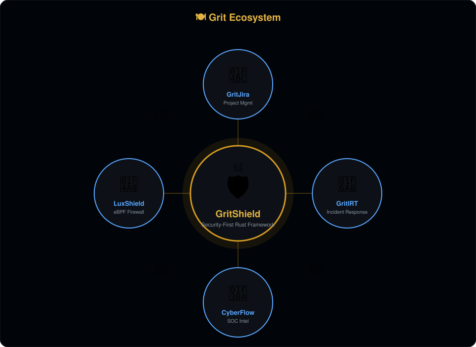

# GritSoc

Docker orchestration for the entire GritShield product stack. One repo, one
command, every service. Each product lives in its own repo and is pulled in as
a git submodule; the shared frameworks (`GritShield`, `Veloasm`) come from
crates.io, so nothing else has to be checked out.



```bash
git clone --recurse-submodules https://github.com/digiator42/GritSoc.git
cd GritSoc
docker compose up --build
```

(Already cloned without submodules? Run `git submodule update --init --recursive`.)

Then open:

| Service | URL | What it is |
|---|---|---|
| Admin Command Center | http://localhost:8000 | Platform UI + API (Postgres) |
| CyberFlow (logs-soc) console | http://localhost:8011 | Live SOC threat console |
| CyberFlow backend API | http://localhost:8010 | Log ingest + threat API |
| LuxShield console | http://localhost:8021 | XDP/WAF console |
| LuxShield backend API | http://localhost:8020 | Packet/DDoS manager |
| GritIRT console | http://localhost:8031 | Incident-response console |
| GritIRT backend API | http://localhost:8030 | Incident/playbook API |
| GritJira console | http://localhost:8041 | Issue tracker UI |
| GritJira backend API | http://localhost:8040 | Issue tracker API (Postgres) |

## Layout

This repo contains the Docker orchestration plus the product repos as
submodules. Every build context is self-contained (framework deps resolve from
crates.io), so `git submodule update --init --recursive` is all you need:

```
GritSoc/
├── admin-command-center/   # submodule: Rust + Postgres
├── logs-soc/               # submodule: CyberFlow — Rust backend + WASM frontend
├── LuxShield/              # submodule: Rust backend + WASM frontend
├── GritIRT/                # submodule: Rust backend + WASM frontend
├── GritJira/               # submodule: Rust backend + Next.js frontend
├── postgres/init.sql       # creates acc_db + grit_jira
├── docker-compose.yml
└── badges/
```

## Ports

Host ports are assigned to avoid collisions (the per-repo composes both used
`8080` for their frontends):

| Host | Container | Service |
|---|---|---|
| 8000 | 8000 | admin-command-center |
| 8010 | 8010 | cyberflow-backend |
| 8011 | 80 | cyberflow-frontend |
| 8020 | 8020 | luxshield-backend |
| 8021 | 80 | luxshield-frontend |
| 8030 | 8030 | gritirt-backend |
| 8031 | 80 | gritirt-frontend |
| 8040 | 8040 | gritjira-backend |
| 8041 | 3000 | gritjira-frontend |

Postgres is internal-only on the compose network (not published).

## Configuration

Everything has a working default, so no `.env` is required. To customize, copy
`.env.example` to `.env` and edit (Postgres creds, API keys, JWT secret, sim
knobs). See `.env.example` for the full list.

## Notes

- `admin-command-center`, `logs-soc` backend, and `GritJira` persist to volumes
  (`pg-data`, `soc-data`, `irt-data`).
- GritJira's Next.js server proxies `/api/*` to `http://gritjira-backend:8040`
  on the compose network (baked at image build via `GRITJIRA_API_URL`).
- The WASM consoles bake `http://127.0.0.1:<port>` as their API base, so they
  talk to the published host ports from the browser.
- LuxShield's eBPF ring overlay (`docker-compose.ebpf.yml` in that repo) is
  Linux/host-network only and is intentionally not part of this stack; the
  default `sim` ring is used here.
